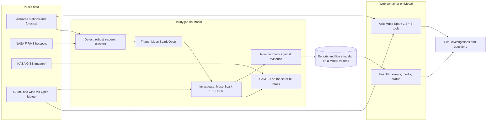

# AirLens Agent

An AI agent that watches Korea's air every hour, works out what caused each pollution event, and
answers anyone's air-quality questions with the evidence and its sources.

Built for the Meta Global AI Developer Hackathon (individual developer track, "Push the
Frontier"). **Built with Muse Spark Open.**

- Live site: https://joymin5655--airlens-agent-web.us-east.modal.run

## What it does

**Investigates pollution events.** Every hour a monitor reads all AirKorea stations (about 670)
and NASA FIRMS fire hotspots. A station is flagged when its PM10 or PM2.5 reaches the "very bad"
grade, or reaches the "bad" grade while standing far above its own previous 7 days (robust
z-score of 3.5 or more). Flagged stations within 40 km form a candidate event. No model is called
for this. For the most severe new regional candidate (at most 4 investigations a day), the agent
goes to work:

1. **Muse Spark Open** (open weights, served on Baseten) triages the candidate: the likely causes
   and what to check.
2. **Muse Spark 1.3** (Meta Model API) tests those hypotheses in a tool loop: station readings,
   fire hotspots, wind, the CAMS forecast, and **SAM 3.1**, which segments smoke or dust on the
   day's NASA GIBS true-colour satellite image so the agent can compare the plume with the
   stations and the fires.
3. Code checks every number the model writes against the collected evidence and drops the claims
   it cannot match. The report gives the cause, a confidence, the evidence behind each claim, the
   other causes it ruled out, its limits, the models used and the cost.

**Answers questions about the air.** On the "Ask about the air" page, Muse Spark 1.3 answers
free-text questions such as "Is the air OK for a run in Seoul tomorrow morning?" with five tools:
place search, live AirKorea readings, the official AirKorea forecast, the CAMS forecast
(worldwide) and today's events. The grade on the answer is computed in code, not by the model:
the official forecast for the place's region when there is one, else the CAMS forecast for the
asked window, else the nearest stations. Answers give air-quality information with sources,
never health or medical advice.

**Replays two real past events** to show the agent telling causes apart:

| Event | Agent's conclusion | Confidence | Cost |
|---|---|---|---|
| Gyeongbuk wildfires, 25 Mar 2025 | Wildfire smoke: SAM 3.1 found 2 smoke regions, one overlapping the event area; 1,042 fire hotspots; fine particles dominate | 0.88 | $0.011 |
| Seoul metropolitan dust, 22 Feb 2026 | Wind-blown dust: coarse particles dominate, no rise in combustion gases, strong westerly flow | 0.82 | $0.010 |

## How it uses Meta models

| Model | Role | Access |
|---|---|---|
| Muse Spark Open | First-pass triage of every candidate event | `meta-models/muse-spark-open-1026` on Baseten |
| Muse Spark 1.3 | Tool-calling investigation and question answering | Meta Model API (`muse-spark-1.3-contributor`) |
| SAM 3.1 | Segments smoke and dust on satellite images to cross-check the sensors | Meta Model API |

The open model takes the cheap first look at every candidate; the stronger tool-using model only
runs where a hypothesis needs testing; SAM 3.1 ties the conclusion to what the satellite saw.

## Model comparison

Each model ran the whole investigation on its own (the first look and the tool loop) with the
same tools and data, SAM 3.1 included, on both past events, twice each, on 4 November 2026. A run
counts as correct when its cause matches the known one and nothing in the run fell back.

| Model | Correct / runs | Mean confidence when correct | Median time per case | Cost per case |
|---|---|---|---|---|
| Muse Spark 1.3 (Meta Model API) | 3 / 4 | 0.86 | 115 s | $0.0066 |
| Muse Spark Open (Baseten) | 4 / 4 | 0.90 | 34 s | $0.0555 |
| OpenAI gpt-6-luna | 3 / 4 | 0.66 | 26 s | $0.0059 |

- Muse Spark Open was right in every run and the most confident, at about eight to nine times
  the cost per case of the other two.
- Muse Spark 1.3's miss is a degraded run: once, the Meta Model API's content filter rejected its
  first-look prompt on the wildfire case, and the run went on with a neutral first look. It still
  named wildfire smoke, but a run that fell back counts as a miss.
- gpt-6-luna called one wildfire run "mixed" and was the least confident of the three.
- No claim in any of the 12 reports had to be removed by the number check. Cost per case covers
  every paid call of the run, SAM 3.1 included. Four runs per model show tendencies, not a
  benchmark. The site shows the same table under "Same cases, three models";
  `uv run airlens-agent eval` runs it again.

## Architecture



- **One writer per database.** The hourly job is the only writer of the live database and the
  reports. The web container reads a read-only copy, keeps its own spend ledger, and each side
  reads the other's ledger so the money caps hold across both.
- **Spend ledger and caps.** Every model call is charged in US dollars. Each provider has an
  all-time cap and a daily cap (Meta $5 a day, Baseten $3 a day); the OpenAI baseline has a hard
  $5 cap. The site allows 300 questions a day in total and 5 a minute or 30 a day per visitor.
  Past the cap it shows a saved example answer and says so.
- **Claim checks.** A number in a report or an answer must match the evidence (within 5 % or the
  rounding), or the sentence is removed and the confidence lowered.
- **Safety.** Sentences that read as personal advice ("you should...", "wear a mask") are removed
  by code, and every answer carries a note that it is air-quality information, not health or
  medical advice. Questions go to Meta's contributor tier and may be used to improve Meta's
  models; the page says so.
- **Tests.** 384 tests with the network mocked, run on every pull request.

## What was built during the hackathon

Everything in this repository was written between 27 October and 4 November 2026 for this
hackathon; the commit history shows each day's work (day 1: data connectors, past-event replay
and detection; day 2: model clients, SAM 3.1 segmentation and the investigation agent; day 3:
the hourly monitor, question answering, the model comparison, the site and the Modal
deployment). The name comes from AirLens (airlens.cloud), the developer's air-quality site; this
project uses none of its code.

### Changes from the application

- Muse Code was not used.
- The comparison baseline is OpenAI `gpt-6-luna` instead of GPT-4o. It runs with
  `reasoning_effort` set to `none`, because Chat Completions supports function calling for this
  model only with that setting (OpenAI model page, checked 4 November 2026).
- Satellite images come from NASA GIBS (MODIS and VIIRS); the planned GK-2A images were not used.
- As planned, there is no own forecast model: forecasts are quoted from AirKorea and CAMS.

## Run it

Python 3.12 and [uv](https://docs.astral.sh/uv/).

```bash
uv sync
cp .env.example .env          # add your own keys; see the comments in the file
uv run pytest -q              # no network, no keys needed
uv run airlens-agent monitor --no-investigate
uv run airlens-agent ask "How is the air in Busan today?"
uv run uvicorn airlens_agent.server:app --port 8000   # the site at http://127.0.0.1:8000
```

`uv run airlens-agent fetch-event <name>`, `replay <name>` and `investigate <name>` rebuild a
past event (`fire-2025-03`, `dust-2026-02`), and `uv run airlens-agent eval` runs the model
comparison. Deployment: [deploy/README.md](deploy/README.md).

## Data sources and credits

- **AirKorea** (Korea Environment Corporation, via data.go.kr): real-time station readings,
  station list, official PM forecast and archived data for the past events. Korea Open Government
  License Type 3.
- **NASA FIRMS**: "We acknowledge the use of data and/or imagery from NASA's Fire Information for
  Resource Management System (FIRMS), part of NASA's Earth Science Data and Information System
  (ESDIS)."
- **NASA GIBS**: "We acknowledge the use of imagery provided by services from NASA's Global
  Imagery Browse Services (GIBS), part of NASA's Earth Science Data and Information System
  (ESDIS)."
- **Copernicus Atmosphere Monitoring Service** forecasts through the Open-Meteo Air Quality API,
  plus Open-Meteo weather and geocoding (CC BY 4.0). Contains modified Copernicus Atmosphere
  Monitoring Service information 2026.
- **Meta models**: Muse Spark Open under the Muse Model License (Built with Muse Spark Open);
  Muse Spark 1.3 and SAM 3.1 through the Meta Model API.

## Limits

- CAMS is a global model with cells of roughly 40 km. Over Korea it often reads higher than the
  official forecast, which is why the official grade comes first; outside Korea the grade is
  indicative.
- The official forecast region is matched through the nearest station's province. Provinces the
  bulletin splits in two (Gyeonggi, Gangwon, Jeonnam-Gwangju) take the worse half.
- The satellite images are daily polar-orbit passes: an image can be a day away from the event
  (the dust case uses the 21 February image), and cloud can hide a plume (SAM 3.1 found no dust
  region in that image).
- The per-visitor limits live in the web process's memory and assume one proxy in front.
- This is air-quality information, not health or medical advice.
